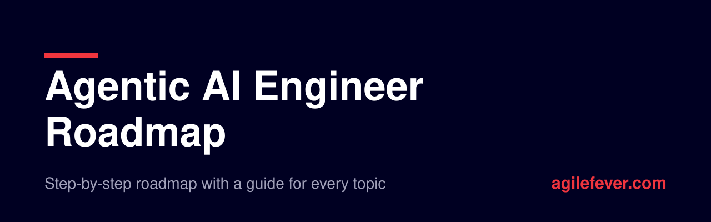

# Agentic AI Engineer Roadmap

> A step-by-step roadmap to become an Agentic AI Engineer: build agents with tools and memory, connect them into multi-agent systems, and run them in production

## Table of Contents

- [Who is an Agentic AI Engineer?](#who-is-an-agentic-ai-engineer)
- [What makes this roadmap different](#what-makes-this-roadmap-different)
- [The Agent Build Path](#the-agent-build-path)
- [How to Use This Roadmap](#how-to-use-this-roadmap)
- [Step 0: Must Know](#step-0-must-know)
- [Step 1: Python, LLMs, and Prompting](#step-1-python-llms-and-prompting)
- [Step 2: Anatomy of an AI Agent](#step-2-anatomy-of-an-ai-agent)
- [Step 3: Agent Architectures, Planning, and Reasoning](#step-3-agent-architectures-planning-and-reasoning)
- [Step 4: Agent Frameworks](#step-4-agent-frameworks)
- [Step 5: Tool Use and Structured Outputs](#step-5-tool-use-and-structured-outputs)
- [Step 6: Memory and Agentic RAG](#step-6-memory-and-agentic-rag)
- [Step 7: Multi-Agent Systems](#step-7-multi-agent-systems)
- [Step 8: Agent Communication Protocols and Workflow Automation](#step-8-agent-communication-protocols-and-workflow-automation)
- [Step 9: Evaluating and Tracing Agents](#step-9-evaluating-and-tracing-agents)
- [Step 10: Safety, Security, and Governance](#step-10-safety-security-and-governance)
- [Step 11: Deploying and Operating Agents](#step-11-deploying-and-operating-agents)
- [Step 12: Enterprise Agents on the Cloud](#step-12-enterprise-agents-on-the-cloud)
- [Step 13: Agent Products and Capstones](#step-13-agent-products-and-capstones)
- [Step 14: Prepare for Agentic AI Interviews and Certification](#step-14-prepare-for-agentic-ai-interviews-and-certification)
- [Learn This Roadmap with a Mentor](#learn-this-roadmap-with-a-mentor)
- [License](#license)

### Prepared and maintained by [AgileFever](https://agilefever.com)

### Follow AgileFever

- [LinkedIn](https://www.linkedin.com/company/agilefever/)
- [YouTube](https://www.youtube.com/@AgileFever)
- [X/Twitter](https://x.com/agilefever)
- [Website](https://agilefever.com)

## Learn with AgileFever

- [GenAI and Agentic AI BootCamp](https://agilefever.com/bootcamps/agentic-ai-bootcamp/)

---

> **Note: We keep updating this roadmap with new topics and blogs.**

---

### Who is an Agentic AI Engineer?

An Agentic AI Engineer builds software where an LLM plans, calls tools, remembers what happened, and works toward a goal with limited supervision.

A GenAI engineer mostly gets good answers from a model. An Agentic AI Engineer makes a model do work reliably, over many steps, without surprising anyone.

### What makes this roadmap different

This roadmap is organised around the agent itself: its parts, how it plans, which tools it can use, how agents work together, and how the whole thing is tested, secured, and run. It assumes you can write basic Python and have used an LLM before.

### The Agent Build Path

| Stage | What you learn | Steps |
| --- | --- | --- |
| Orient | What agents are and why they matter | Step 0 |
| Prepare | Python, LLMs, prompts and context | Step 1 |
| Build one agent | Anatomy, planning, frameworks, tools, memory | Step 2 to Step 6 |
| Connect agents | Multi-agent systems and protocols | Step 7, Step 8 |
| Make it trustworthy | Evaluation, safety, governance | Step 9, Step 10 |
| Run it | Deployment, cloud, products | Step 11 to Step 13 |
| Get hired | Interviews and certification | Step 14 |

### How to Use This Roadmap

This roadmap can be followed in the given order by anyone who can write basic code.

- Follow the steps in order. Each step builds on the previous one.
- Inside each step, read the blogs in the given order. Each blog explains one idea in plain words.
- Topics without a link are covered in the course. Use the official documentation of the tool while you practise them.
- After every step, ask yourself: "Could I sketch the agent for this task, name its tools, and say how I would test it?" If yes, move on.
- Build something small at the end of each step. Reading alone does not make an agent engineer.

Let's get started.

### Step 0: Must Know

An agent is a program where an LLM decides what to do next, calls tools, and keeps going until a goal is met. Start here to see how that differs from a chatbot, and what the job of an Agentic AI Engineer looks like.

- [What Is Agentic AI? A Complete Beginner's Guide](https://agilefever.com/what-is-agentic-ai/)
- [Agentic AI vs Generative AI](https://agilefever.com/agentic-ai-vs-generative-ai/)
- [How to Start Learning AI Agents](https://agilefever.com/how-to-start-learning-ai-agents/)
- [How to Learn Agentic AI: a step-by-step path](https://agilefever.com/how-to-learn-agentic-ai/)
- [Agentic AI Engineer: skills, tools, and career path](https://agilefever.com/agentic-ai-engineer-roadmap-skills-tools-career-path/)
- [Mastering Agentic AI: build and deploy AI agents](https://agilefever.com/agentic-ai-build-deploy-ai-agents-bootcamp/)

**Checkpoint:** Explain the difference between a chatbot, a workflow, and an agent.

### Step 1: Python, LLMs, and Prompting

Agents are built from ordinary code plus an LLM API. We need Python, API calls, and a working picture of how an LLM behaves, and we need prompts and context handled well, before we add autonomy.

- [Python for AI roadmap](https://agilefever.com/python-for-ai-roadmap/)
- [Python for AI: the free starter course](https://agilefever.com/python-for-ai-free-course-who-should-take-it/)
- JSON, APIs, and data handling in Python
- [Large Language Models: a complete guide](https://agilefever.com/large-language-models-llm-guide/)
- Calling LLM APIs: OpenAI, Claude, and Gemini
- [Artificial intelligence terms from A to Z](https://agilefever.com/artificial-intelligence-terms-ai-glossary-examples/)
- Prompt structure, few-shot, and chain-of-thought
- [Prompt engineering vs context engineering](https://agilefever.com/prompt-engineering-vs-context-engineering/)
- Context windows, compression, pruning, and budgeting

**Checkpoint:** Call an LLM API from Python and get a structured answer.

### Step 2: Anatomy of an AI Agent

Every agent has the same parts: a model that reasons, a planner, an executor, tools, and memory. Knowing the parts makes every framework easier to read.

- [Agentic AI architecture: planner, memory, tools, reflection](https://agilefever.com/agentic-ai-architecture-planner-memory-tools-reflection/)
- LLMs as reasoning engines
- Planner, executor, tools, and memory
- Build a rule-based planning agent with memory
- [Solution architecture patterns for agentic systems](https://agilefever.com/agentic-ai-architecture-patterns-solution-architects/)

**Checkpoint:** Draw the parts of an agent and say what each one does.

### Step 3: Agent Architectures, Planning, and Reasoning

Different tasks need different control loops. In this step we compare the main patterns and teach agents to break a goal into steps and adapt when a step fails.

- ReAct
- Plan-and-Execute
- Tree of Thought
- Goal decomposition and task queues
- Multi-step planning and dynamic tool chaining
- Decision making under constraints
- Build a goal-seeking assistant

**Checkpoint:** Pick a pattern for a task and say why you did not pick the others.

### Step 4: Agent Frameworks

Frameworks save time but hide choices. We build the same workflow in more than one framework and learn to pick based on control, state handling, and scale.

- [AI agent frameworks compared: LangGraph, CrewAI, AutoGen](https://agilefever.com/ai-agent-frameworks-compared/)
- [LangChain and LangSmith from experiment to production](https://agilefever.com/build-production-ready-llm-langchain-framework/)
- LangGraph: state, graphs, and control flow
- CrewAI: role-based crews
- AutoGen: conversational agents
- Orchestration patterns and framework selection
- [Four ways to build agents: code, low-code, cloud, and custom](https://agilefever.com/agentic-ai-skills-you-will-build-in-the-bootcamp/)

**Checkpoint:** Build the same small workflow in two frameworks and compare them.

### Step 5: Tool Use and Structured Outputs

Tools are how an agent touches the world. The hard part is making tool calls reliable, so we focus on schemas, validation, and what to do when a call fails.

- Function calling
- Structured outputs and JSON mode
- Pydantic validation and output parsers
- API calling, browser tools, and file system operations
- Retry strategies and reliable agent responses
- [Model Context Protocol (MCP) explained](https://agilefever.com/model-context-protocol-explained/)
- Build an agent that queries web APIs and updates documents

**Checkpoint:** Give an agent two tools with validated inputs and handle a failed call.

### Step 6: Memory and Agentic RAG

An agent that forgets everything is not useful. We add short-term and long-term memory, and let the agent decide when and how to retrieve knowledge.

- Short-term and long-term memory
- Vector memory with FAISS and Pinecone
- Memory persistence in LangGraph
- Context retention strategies
- Agentic RAG: retrieval loops, web search, and tools
- Build a chatbot with persistent user memory

**Checkpoint:** Make an agent remember a user across two sessions.

### Step 7: Multi-Agent Systems

Some problems split naturally between roles. We learn how agents hand work to each other, and when one agent is the better choice.

- [Single-agent vs multi-agent systems](https://agilefever.com/single-agent-system-vs-multi-agent-system/)
- Role-based orchestration with CrewAI and AutoGen
- CAMEL and agent negotiation
- Message passing between agents
- Collaborative agent systems
- Build buyer and seller agents that simulate a transaction

**Checkpoint:** Run two agents with different roles on one task.

### Step 8: Agent Communication Protocols and Workflow Automation

Agents increasingly talk to tools and to each other through shared protocols. We compare MCP, A2A, and ACP, and see where a visual workflow tool is enough.

- [Model Context Protocol (MCP)](https://agilefever.com/model-context-protocol-explained/)
- A2A: Agent-to-Agent protocol
- ACP: Agent Communication Protocol
- MCP vs A2A vs ACP: when to use which
- Communication patterns and collaboration workflows
- Workflow automation with n8n: triggers, nodes, and AI agents

**Checkpoint:** Expose one tool through MCP and call it from an agent.

### Step 9: Evaluating and Tracing Agents

Agents fail in ways a single prompt does not: wrong tool, loops, partial results. We measure task completion and read traces to find the cause.

- [How to evaluate an LLM application](https://agilefever.com/evaluate-llm-application/)
- RAG evaluation with RAGAS and DeepEval
- Accuracy, relevance, faithfulness, and hallucination
- Agent performance and reliability metrics
- Tracing agent runs and tool calls
- Finding failures and improving agent behaviour

**Checkpoint:** Write ten test cases for an agent and read one full trace.

### Step 10: Safety, Security, and Governance

An agent that can act can also do damage. We set limits on what it may do, defend against injected instructions, and keep humans in the loop where it matters.

- [Prompt injection and guardrails](https://agilefever.com/prompt-injection-guardrails/)
- Input sanitization and output filtering
- Tool permission scoping and sandboxing agent actions
- Loop prevention and constraint design
- Trust boundaries and permission control
- Goal alignment and agent governance
- Build a goal-chasing agent with safety checks

**Checkpoint:** Show an agent refusing a prompt injection and a risky action.

### Step 11: Deploying and Operating Agents

This step is the operations side of agents: packaging, hosting, watching, and keeping costs under control.

- Dockerizing agents
- Deploying on Hugging Face Spaces, AWS Lambda, and Google Cloud
- [LLMOps vs MLOps](https://agilefever.com/llmops-vs-mlops/)
- [LLMOps and AgenticOps skills](https://agilefever.com/llmops-agenticops-skills-mlops-bootcamp/)
- [MLOps, LLMOps, and Agentic AI Ops: the complete guide](https://agilefever.com/mlops-llmops-agentic-ai-ops-bootcamp-complete-guide/)
- Deployment strategies and production readiness
- Monitoring, logging, and cost control

**Checkpoint:** Deploy an agent and check its logs and cost.

### Step 12: Enterprise Agents on the Cloud

Large organisations build agents on managed cloud platforms. We look at Azure, AWS, and Google Cloud, and learn to move an agent from a laptop to one of them.

- [Enterprise AI agents on Azure, AWS, and Google Cloud](https://agilefever.com/enterprise-ai-agents-on-cloud-guide/)
- [Enterprise AI agents on Azure: module by module](https://agilefever.com/enterprise-ai-agents-on-azure-curriculum-breakdown/)
- [Azure vs AWS vs Google Cloud for AI agents](https://agilefever.com/azure-vs-aws-vs-google-cloud-ai-agents/)
- [Cloud AI agent skills you will build](https://agilefever.com/cloud-ai-agent-skills-azure-aws-google-cloud-courses/)
- Semantic Kernel and Azure AI Search for enterprise RAG
- Convert a CrewAI or LangGraph agent into a cloud system

**Checkpoint:** Move one agent to a managed cloud service.

### Step 13: Agent Products and Capstones

Finally we turn agents into products people can use, and put the skills together in domain projects.

- Agent-as-a-Service: monetizable agents and SaaS business models
- Travel planner and sales bot agents
- Persistent jobs and dashboards
- Domain capstones in finance, insurance, healthcare, and retail
- [Agentic AI Course syllabus checklist](https://agilefever.com/agentic-ai-course-syllabus-checklist/)

**Checkpoint:** Wrap an agent as a small service with a clear use case.

### Step 14: Prepare for Agentic AI Interviews and Certification

Interviews for this role ask you to design an agent on the spot, defend your choice of pattern, and explain how you would test and secure it. A certificate is optional, but some credentials from model providers are well recognised.

- [Agentic AI certification: do you really need one?](https://agilefever.com/agentic-ai-certification-do-you-really-need-one/)
- [Best Agentic AI bootcamp, course, and training](https://agilefever.com/best-agentic-ai-course-training-program-bootcamp/)
- [Agentic AI workshop vs bootcamp](https://agilefever.com/agentic-ai-workshop-vs-bootcamp/)
- [What is the Claude Certified Architect (CCA) Foundations certification?](https://agilefever.com/what-is-claude-certified-architect-foundations-certification/)
- [CCA-F syllabus explained](https://agilefever.com/claude-cca-f-foundations-exam-syllabus-explained/)
- [CCA-F study plan](https://agilefever.com/cca-f-study-plan-4-week-execution-pass-first-attempt/)
- [CCA-F practice questions](https://agilefever.com/cca-f-practice-questions/)

**Checkpoint:** Sketch an agent design for a new task and defend it out loud.

Interviews usually test three things:

- **Agent design:** pick a pattern for a given task and justify it. Steps 2 to 4 and Step 7.
- **Reliability:** show how you would test, trace, and secure the agent. Steps 5, 9, and 10.
- **Operations:** explain how it is deployed and watched. Steps 11 and 12.

### Learn This Roadmap with a Mentor

The [GenAI and Agentic AI BootCamp](https://agilefever.com/bootcamps/agentic-ai-bootcamp/) follows this path in live sessions, with agent projects at every stage and domain capstones at the end. It is a good fit if you want feedback on your own agent builds.

### License

This roadmap is licensed under CC BY 4.0. You may share and adapt it with credit to AgileFever.
